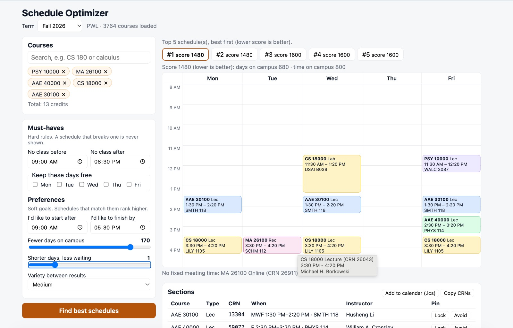
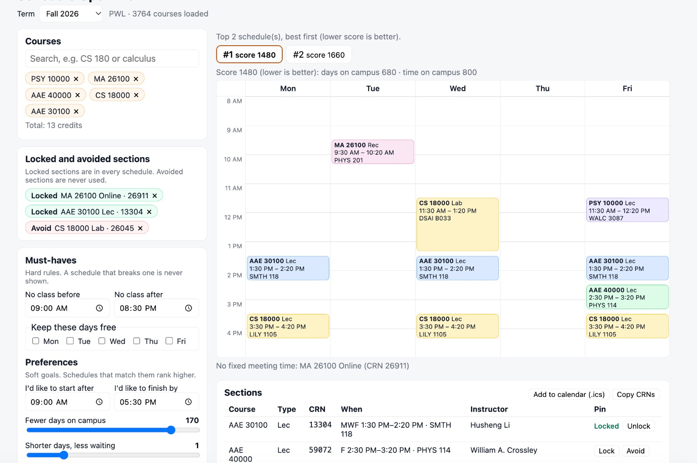
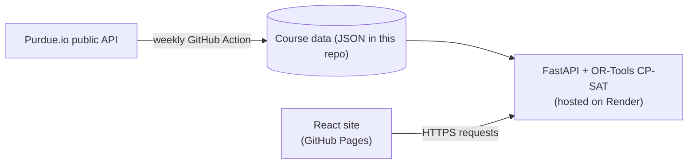

# Schedule Optimizer

Pick your courses, set your rules, and get the best conflict-free class schedules, ranked by what
you care about. Built for Purdue University (West Lafayette) using public course data.

**Live demo: https://krisha-codes.github.io/schedule-optimizer/**
*(The free server sleeps when idle, so the first load can take up to a minute.)*



## What it does

- **Course search** for any term with data. Type `cs180` or `calculus`.
- **Must-haves:** no class before or after a time, and days you want free. A schedule that breaks
  one is never shown.
- **Preferences:** fewer days on campus, shorter days with less waiting, preferred hours. Set with
  sliders.
- **Ranked results:** the top 5 schedules with a readable score ("days on campus 180 · time on
  campus 270") and a weekly calendar.
- **Lock and avoid sections:** register for one class, lock it, and the other schedules rebuild
  around it.
- **Linked sections handled:** a lecture is only combined with the labs and recitations that belong
  to it.
- **Calendar export:** download a `.ics` file with weekly repeats, correct time zone and daylight
  saving.
- **New terms appear automatically** once Purdue publishes them (a weekly GitHub Action).



## How it works



### The optimization model

Scheduling is modeled as a constraint-satisfaction and optimization problem and solved with
Google OR-Tools CP-SAT.

- **One option per course.** An option is a class: a lecture plus the labs or recitations linked to
  it. The solver picks exactly one option per course, and exactly one section of each type inside it.
- **No overlaps.** Every pair of sections whose meetings overlap gets an "at most one" constraint.
  Overlap accounts for days, times, and date ranges, so two half-semester sections can share a slot.
- **Hard rules** remove sections before the model is built. Locked sections pin a choice.
- **Soft preferences** become a linear objective: per-section costs (early or late minutes,
  instructors) plus per-day variables for "day used" and "time from first class to last class".
- **Top results.** Solve, forbid that answer (and near-copies, with a "variety" setting), solve
  again.
- **Checked twice.** Every optimal answer is re-scored by independent plain-Python code; a mismatch
  raises an error.

## Tech

Python 3.12, FastAPI, Google OR-Tools (CP-SAT), React, Vite, pytest, GitHub Pages, Render,
GitHub Actions.

## Run it locally

```bash
# backend (Python 3.12: OR-Tools wheels can lag the newest Python)
cd backend
python3.12 -m venv .venv && source .venv/bin/activate
pip install -r requirements-dev.txt
python refresh_data.py        # downloads current terms; takes several minutes
uvicorn api:app --reload

# frontend (new terminal)
cd frontend
npm install
npm run dev
```

Open http://localhost:5173. Tests: `pytest` in `backend`, `npm run lint` and `npm run build` in
`frontend`.

## Project layout

```
backend/    FastAPI app (api.py), solver (solver.py), ranking (ranking.py),
            data download (fetch_data.py, refresh_data.py), tests
frontend/   React app
render.yaml, .github/workflows/    deployment and weekly data refresh
```

## Limits

- Unofficial and not affiliated with Purdue University. Always confirm CRNs in myPurdue before
  registering.
- Course data comes from the community-run [Purdue.io](https://github.com/Purdue-io/PurdueApi) API.
  Seat availability is not included.
- The calendar file does not skip university holidays or include exams.
- Walking time between buildings is not modeled yet.
- Section linking follows how Purdue.io groups classes.

## Ideas for next

Walking-time penalties, grade and difficulty data in the score, a browser extension that suggests
schedules inside myPurdue.

## License

MIT
